<div align="center">

# System One Harness

### Small decisions. Reusable blocks. Your own flows.

[](https://github.com/SharonLanger/system-one-harness/actions/workflows/offline-tests.yml)
[](LICENSE)
[](#project-status-and-community)
[](plugins/hook-laya/README.md)



**[Set up](#set-up-a-development-checkout)** · **[Run tests](#run-tests)** · **[How it works](#how-it-works)**

</div>

System One Harness (SOH) is a personal experimental project I built for fun. Compose reusable Laya question blocks, explicit decision rules, and deterministic tools into Python flows, then connect those flows to Claude Code through a plugin.

## Build once, reuse across flows

A question block packages a focused model decision behind a defined input and output contract. A flow combines those blocks with ordinary code and tools. Reuse a block in another flow, or adapt its questions, rules, and input preparation through its supported overrides.

| Piece | What you can inspect and reuse |
| --- | --- |
| [Question blocks](src/building_blocks/questions/) | Structured inputs, decisions, domain outputs, and reasons for skipping or declining a selection. |
| [Block runtime](src/block_runtime/README.md) | Input/output validation, question and rule overrides, preparation, and result reduction. |
| [Deterministic tools](typescript-helper/README.md) | TypeScript outlines, source extraction, and navigation without a model decision. |
| [Method-selection evaluation](src/building_blocks/questions/method_selection_v2/README.md) | Compared question/rule profiles, correct and incorrect selections, and missed targets. Development results are documented; held-out validation is pending. |

A block result exposes its status, decisions, and domain data. Those outputs explain what happened in a call; evaluation results describe how well a particular configuration performed on a particular dataset. Changing questions or rules requires checking the new configuration rather than assuming the old measurements still apply.

Before promoting a new question into a block, try it in an experiment project. I use [System One Experiments](https://github.com/SharonLanger/system-one-experiments), a separate repository that is currently private, for this work.

## Package flows into a plugin

The [included Claude Code plugin](plugins/hook-laya/README.md) connects hook events to SOH. Flows are ordinary Python code; handlers and routing are wired explicitly. The current integration handles `UserPromptSubmit` and `PostCompact` synchronously.

The diagram below shows the **planned routing model**: Event 1 invokes Flow A, Event 2 invokes Flow B, and Event 3 invokes both concurrently. The animation cycles through the three routes; only the selected paths light up. Automatic multi-flow routing, concurrent execution, and combining their results are future work.



Flow results return through the hook integration to the host harness, such as Claude Code. Installing the plugin connects it to Claude Code; real Laya inference currently runs locally on an Apple Silicon Mac.

## Requirements

- Python 3.11 or newer on macOS or Linux. The hook gateway uses POSIX timer APIs.
- Node.js and npm to build the TypeScript source helper. CI uses Node 24.
- For real inference: the [Laya-MLX runtime](https://github.com/mizorewww/laya-mlx), access to the [default Laya model](https://huggingface.co/aac6fef/laya-typed-decisions-mlx), and an Apple Silicon Mac. Installing SOH does not install Laya or download model weights. Their licenses and support terms are separate from this repository's [Apache-2.0 license](LICENSE).

## Set up a development checkout

From the repository root, in a fresh Python environment:

```bash
python3 -m venv .venv
source .venv/bin/activate
python -m pip install --upgrade pip setuptools wheel
python -m pip install -e '.[test]'
python -m playwright install chromium
npm ci --prefix typescript-helper
npm run build --prefix typescript-helper
python -m cli doctor
```

Chromium is used by the viewer's browser tests. On a minimal Linux system, use `python -m playwright install --with-deps chromium` to install its system dependencies too. The installed viewer uses your normal browser and does not require Playwright or Node.

`doctor` checks the local Python, gateway timer, and log path. It does **not** check the model, Node build, or Claude plugin. The TypeScript build creates the helper under `build/typescript/`; rebuild it after editing `typescript-helper/src/`.

To see the CLI interface without a model:

```bash
python -m cli --help
```

For real model setup and an explicit first probe, follow [the Mac guide](docs/real-laya-mac.md). To connect the hook to Claude Code, follow [the plugin setup guide](plugins/hook-laya/README.md). The installed CLI is `system-one-harness`; `laya-context-router` remains a compatibility alias. No setup command above registers the hook or modifies Claude settings.

## Run tests

After the setup above:

```bash
python -m pytest -q
npm test --prefix typescript-helper
python scripts/check_repository_hygiene.py
```

The Python suite includes unit, integration, system, and existing active tests. See [the test guide](tests/README.md) for suite boundaries and how to find each job's results on GitHub. The experiment-derived checks in `tests/deferred/` are deliberately excluded from the ordinary test command; they are retained for later migration and are not counted as passing coverage. The TypeScript tests run separately with Node. GitHub Actions runs these checks on pull requests.

## How it works

### First proof of concept: method context

The public hook gateway reads one JSON event from stdin. It validates the hook name and event, dispatches `UserPromptSubmit` or `PostCompact`, and writes only the hook protocol response to stdout. The current prompt flow resolves one production TypeScript file, asks the model to classify the requested action and choose a callable, then extracts bounded method context. A session store suppresses repeated enrichment until compaction. Diagnostics go to stderr and `.logs/YYYY-MM-DD/HH-00.jsonl` in UTC. Installed copies use the user-local log directory, or an absolute `SOH_LOG_ROOT` override. Session state uses Python’s standard-library SQLite at `<SOH root>/.soh/session-state.sqlite3`, shared by sessions in this installation. The database path stays anchored to the installed SOH package/checkout, independent of the target project and cwd. Logs may contain prompts, model responses, or source code, so handle them as potentially sensitive. Session state is also sensitive local data: never commit, merge, or upload its database or sidecars. SQLite starts empty; existing JSONL is neither imported nor deleted. There is no retention, pruning, automatic vacuum, encryption, or database size cap. Node remains required for TypeScript source analysis; session persistence uses Python only. See [session storage](docs/session-state.md).

The first flow demonstrates the pieces working together. For a request such as:

```text
Explain `src/service.ts`: how does calculate work?
```

Laya question blocks classify the request and select a callable. Deterministic TypeScript tools extract the selected source and, where available and within budget, its direct outgoing call locations. Session history suppresses repeated enrichment until compaction.



The animation cycles through five examples: explain a method, generate tests, request a modification, ask about an unclear method, and reference a missing file. Green paths add context; amber paths return no added context and Claude continues. Timing is illustrative.

The gateway returns `hookSpecificOutput.additionalContext`, or no added context for a skip or failure. The offline tests script Laya responses while exercising harness behavior; they do not establish live model quality or verify a real Claude Code session.

**[Explore the flow, results, and source →](docs/flows/method-context.md)**

For manual registration, see [hook usage](docs/hook-usage.md). [Configuration conventions](docs/configuration-conventions.md) explain question and policy JSON formats.

## Project status and community

SOH is an experimental research prototype made for fun, not a stable published package or hosted service. Real inference currently requires local setup. Tests exercise the harness with controlled responses; they do not establish the model's answer quality. Some historical experiment checks remain deferred.

For bugs and changes, read [CONTRIBUTING.md](CONTRIBUTING.md). To report a vulnerability privately, read [SECURITY.md](SECURITY.md). Project-owned source is offered under [Apache License 2.0](LICENSE); separately obtained runtimes and model weights have their own terms.

## Local log viewer

Run `system-one-harness logs --ui` to open a local browser search over the existing hourly JSONL log root. Use `--no-open` to print the authorized local URL without opening a browser. Leave the command running while using the viewer; Ctrl-C stops it. If the browser does not open, use the printed URL.

The viewer uses an absolute `SOH_LOG_ROOT` override, the checkout's `.logs`, or the installed user-state log location. Viewing never creates or modifies a log root. Existing `logs --last N` is unchanged; `--ui` cannot be combined with explicitly supplied `--last`, and `--no-open` requires `--ui`.

The page starts with filters only (Past hour / All levels). Prepare exact session, correlation, flow, component/type, levels, event, hook, UTC range and literal text filters, then press **Run search**. Draft changes do not execute or change submitted results. All-history session/invocation shortcuts prepare a new draft; Run applies it. Load more continues the submitted snapshot; Refresh captures new records. Display order is file/append order, not strict timestamp order. Diagnostics explain unreadable/corrupt/deferred data and incomplete coverage.

Categorical values match exactly; enter multiple values on separate lines to match any of them. Different filters combine with AND. Use **Include null** for missing context; the text `null` is a different value. Dates use UTC with an inclusive start and exclusive end. Text search is a case-insensitive literal substring; searching JSON details is opt-in. Selecting a row shows its full message and original JSON.

The viewer reads existing files across hours and days, including gaps, and pauses at a full page. It retains at most five pages/1,000 summaries; evicted history requires a new search. An interrupted advance offers **Retry current page** against the same snapshot. Queries expire after 15 idle minutes. Lines larger than 4 MiB are skipped with diagnostics. Broad searches still scan files, so their speed depends on log volume; startup performs no scan. Real-log performance and macOS viewer behavior have not yet been validated; automated browser coverage uses Linux/Chromium and synthetic logs.

The viewer is loopback-only, token protected, packaged with the Python install, and uses no hosted service, database or Docker. Keep the printed launch URL local. See the [API and query semantics](docs/log-viewer/API.md) and [scenario contracts and test commands](tests/log_viewer_contracts/README.md).

### Change log

- 2026-11-09: Added `logs --ui` for local filtering and JSON inspection across hourly files, with explicit Run, snapshot pagination, cancellation, refresh and interrupted-page recovery. Scenario contracts LV01–LV16 cover these behaviors. Future behavior changes should update the affected cases and record their reason here; CI reports validation for each commit.
