# Method-context flow

[Back to the project README](../../README.md#how-it-works)

This flow demonstrates reusable Laya blocks working with deterministic TypeScript tools. It accepts a prompt referencing one eligible production TypeScript file and can add the selected method's context to Claude Code.

The animation shows five representative cases, including two successful actions and three paths that add no context. The final preparation box groups source verification, output budgets, and session deduplication; the numbered steps below give the details. It is an illustration of current control flow, not a live trace or a latency measurement.

## Current execution

1. The [gateway](../../src/hooks/gateway.py) validates the hook payload and enforces a deadline. The [dispatcher](../../src/hooks/dispatcher.py) routes the event to its handler.
2. The [flow](../../src/flows/first_method_context.py) resolves one eligible file within the project. Test files and declarations are excluded.
3. The requested-action block classifies the prompt. The flow supports explaining code and generating tests; other actions produce no added context.
4. The TypeScript helper builds an outline. The [method-selection block](../../src/building_blocks/questions/method_selection_v2/README.md) uses the prompt and outline to select one candidate, subject to its decision rules.
5. The helper extracts source, verifies its identity, and looks up direct outgoing call locations. The flow applies its output budget and rechecks the source.
6. The session-state transaction decides whether the same method has already been enriched since compaction. A duplicate produces no added context. Ordinary state-store errors currently preserve the context; deadlines still apply.
7. The gateway serializes accepted context as `hookSpecificOutput.additionalContext`. Noop and Failure outcomes produce no context payload; diagnostics are kept off protocol stdout.

## What you can inspect

The method-selection block exposes a selected ID or a domain reason, along with candidate/label maps. The generic block result also exposes status, decisions, and data. See its contract before using the block in another flow.

The [requested-action](../../src/building_blocks/questions/requested_action/README.md) and [method-selection](../../src/building_blocks/questions/method_selection_v2/README.md) contracts describe current defaults and their limitations. A rule acceptance is not a correctness guarantee. Run the [offline flow and hook sanity examples](../../examples/README.md) to see the component chain with explicitly scripted model answers.

## Session lifecycle and limits

`PostCompact` is a separate event route. It appends a shared compaction marker to the session's SQLite history so later requests can enrich again. It does not save the compaction summary. The database is `<SOH root>/.soh/session-state.sqlite3`, independent of the target project. See [session storage](../session-state.md) for transaction, failure and retention behavior. [Diagnostic logs](../log-viewer/DATA_MODEL.md) are separate and may contain prompts or source code.

The root README's concurrent A/B routing diagram describes a planned capability. This flow uses synchronous event handlers.

Offline tests use scripted Laya responses. They validate harness behavior, not real-model accuracy or installation into a live Claude Code session. See the [test guide](../../tests/README.md) and [plugin setup](../../plugins/README.md).
